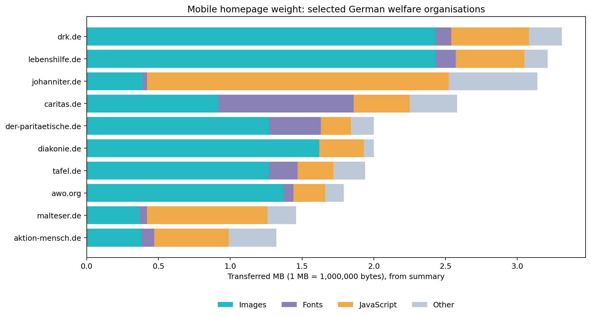
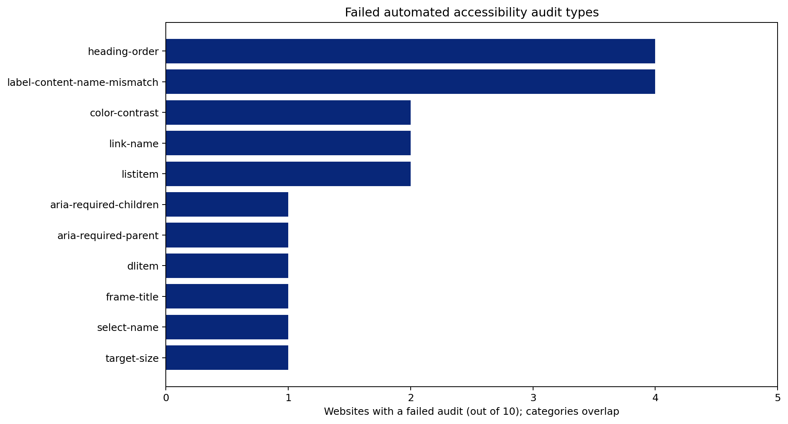

# Making nonprofit websites easier to use

A pilot study of mobile homepage weight and automated accessibility findings for ten German social welfare organisations, using HTTP Archive. Created for the DSSG Berlin × DSSG NYC Datathon 2026.

**Research question:** Which observable technical barriers deserve investigation, and which recommendations might help more than one website?

## Findings

- 7 of 10 sampled pages have at least one failed automated accessibility audit.
- 11 audit types fail across 20 site-audit pairs. These are not 20 unique elements.
- Heading order and visible-label/accessibility-name mismatches each occur on 4 websites.
- Images account for about 73% of DRK homepage weight and 76% for Lebenshilfe.
- Fonts account for about 36% of Caritas homepage weight.

These findings identify investigation priorities, not proven user exclusion, measured savings or current legal noncompliance.





## Scope

Ten purposively selected main homepages: Aktion Mensch, AWO, Caritas, Der Paritätische, Diakonie, DRK, Johanniter, Lebenshilfe, Malteser and Tafel. Exact URLs are in `data/site_metrics.csv`. This is not a representative sample of the nonprofit sector.

Source: `httparchive.crawl.pages`, monthly partition `2026-10-01`, `client = 'mobile'`, `is_root_page = TRUE`. The monthly partition date is not the exact test date. Failed-audit records include actual Lighthouse timestamps from October 13–15, 2026.

## Reproduce locally

No Google credentials or BigQuery access are needed to analyse the included exports.

```bash
python -m venv .venv
source .venv/bin/activate
pip install -r requirements.txt
python scripts/analyse.py
```

The script validates the cohort and unique site-audit pairs, prints the headline counts and regenerates both figures. Exported metrics are rounded to two decimal MB, so calculated proportions are approximate.

## Re-run data extraction

Queries are in `sql/`. Inspect the live table schema before using a different crawl. In BigQuery, dry-run each query and set a maximum bytes billed limit appropriate to your budget. `LIMIT` is not a scan-cost control. Exact URL filtering does not guarantee a tiny scan, especially when reading JSON columns. The queries do not run from the local analysis script.

## Files

- `REPORT.md`: findings, recommendations and interpretation limits.
- `data/`: the two analysis exports, including detailed failed-audit evidence.
- `sql/`: BigQuery extraction queries.
- `scripts/analyse.py`: local analysis and figure generation.
- `figures/`: generated charts with English labels.
- `presentation/`: four-slide English pitch with editable charts and speaker notes.

## Manual verification status

DRK: the user could not locate the two archived select fields on the current homepage, including in a 412 px viewport and searches by element ID. This does not prove remediation. Caritas: current-page verification is pending. No fixes or user-impact evaluation have been completed.

## Interpretation limits

Automated audits cover only part of accessibility. A score of 100 does not establish full accessibility. Missing or non-applicable audits are not failures. The failed-audits export alone cannot establish how many checks ran or were applicable. Homepage observations do not measure the full service journey. Resource weight does not establish loading speed, and detection of the same CMS does not establish a common cause.

## Sources and acknowledgements

Data: [HTTP Archive](https://httparchive.org/), [documentation](https://httparchive.org/docs/). Thanks to HTTP Archive and the datathon organisers. 
